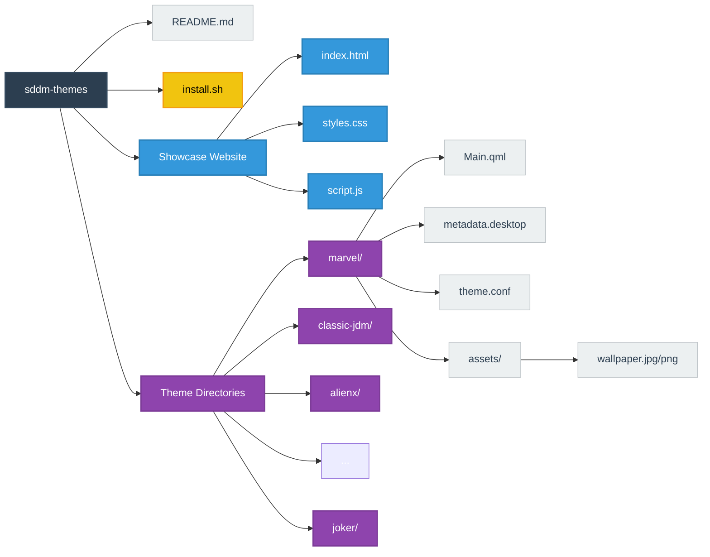

# SDDM Themes ! 

For reference visit the showcase → **[kadhiravaneg.github.io/sddm-themes](https://kadhiravaneg.github.io/sddm-themes)**

44 self-contained SDDM (Qt5/Qt6) themes, each built around one of the
reference wallpapers with a **deliberately different layout structure** —
no shared components, no copy-paste UI. Pick the one you want and install it.

## 44 Themes Gallery

| Theme | Preview | Theme | Preview | Theme | Preview |
|---|---|---|---|---|---|
| `alienx` |  | `bmw` |  | `bmw-m3` |  |
| `cat-pond` |  | `classic-jdm` |  | `cosmic-gateway` |  |
| `deadpool` |  | `dodge` |  | `drag-racer` |  |
| `everest` |  | `fish-in-rock-pond` |  | `gojo` |  |
| `hilda-and-tepig` |  | `hitagi-senjougahara` |  | `hoodie` |  |
| `joker` |  | `kawaii` |  | `marvel` |  |
| `mazda-mx5` |  | `moonlit-rooftop-cat` |  | `mount-fuji` |  |
| `mountain-sunset` |  | `neko-anime` |  | `neon-gif` |  |
| `neverness-to-everness` |  | `nissan` |  | `nissan-skyline` |  |
| `ocean-in-jar` |  | `oni-anime-girl` |  | `oni-robot` |  |
| `pink-bloom` |  | `pirates-of-the-caribbean` |  | `pixel-gaming-room` |  |
| `pixel-sakura-city` |  | `pokeball` |  | `purrple-cat` |  |
| `rdr2` |  | `sakura-lake` |  | `spiderman` |  |
| `spiderverse` |  | `super-mario-pixel` |  | `the-dark-river` |  |
| `zoro-blue` |  | `zoro-dragon` |  | | |

---

## Requirements

Install these before running the install script.

| Distro       | Command                                                                 |
| ------------ | ----------------------------------------------------------------------- |
| **Arch**     | `pacman -S sddm qt5-quickcontrols2 qt5-graphicaleffects qt5-declarative` |
| **Fedora**   | `dnf install sddm qt5-qtdeclarative qt5-qtgraphicaleffects`             |
| **Debian/Ubuntu** | `apt install sddm qml-module-qtquick2 qml-module-qtgraphicaleffects qml-module-qtquick-controls2` |
| **openSUSE** | `zypper install sddm libqt5-qtdeclarative qt5-graphicaleffects`         |

> The install script auto-detects your Qt version (Qt5 or Qt6) and patches
> import lines automatically — no manual editing needed.

---

## Install

```bash
git clone https://github.com/KADHIRAVANEG/sddm-themes
cd sddm-themes
sudo ./install.sh marvel        # replace marvel with any theme id above
systemctl restart sddm          # or reboot
```

The script:
- Detects Qt5 / Qt6 and patches QML imports automatically
- Copies the theme to `/usr/share/sddm/themes/<id>`
- Sets `Current=<id>` in `/etc/sddm.conf`
- Backs up any existing theme before overwriting

---

## Preview without rebooting

```bash
sddm-greeter --test-mode --theme /usr/share/sddm/themes/marvel
# Qt6 systems:
sddm-greeter-qt6 --test-mode --theme /usr/share/sddm/themes/marvel
```

---

## Customize

Each theme has its own `theme.conf` with a `brand` accent colour and
`background` path. Drop in a different wallpaper at
`<theme>/assets/wallpaper.*` and reinstall.

```ini
[General]
background=assets/wallpaper.jpg
brand=#ed1d24
```

---

## Showcase website

A static showcase is included at the repo root — plain HTML / CSS / JS,
zero build step.

```bash
# open directly
xdg-open index.html

# or serve locally
python3 -m http.server 8000
```

---

## Structure

```
sddm-themes/
├── README.md
├── install.sh
├── index.html              ← showcase website
├── styles.css
├── script.js
├── marvel/
├── classic-jdm/
├── alienx/
├── drag-racer/
├── gojo/
├── kawaii/
├── joker/
├── rdr2/
├── deadpool/
├── bmw/
└── <each theme>/
    ├── Main.qml
    ├── metadata.desktop
    ├── theme.conf
    └── assets/wallpaper.{jpg,png}
```

## Flow chart



---

## Notes

- SDDM ≥ 0.19 required
- These themes only render on a real Linux machine with SDDM/Qt installed —
  the web showcase displays wallpapers and metadata only
- Tested on Arch Linux with Hyprland and KDE Plasma

---

## License

MIT — see [LICENSE](LICENSE)
